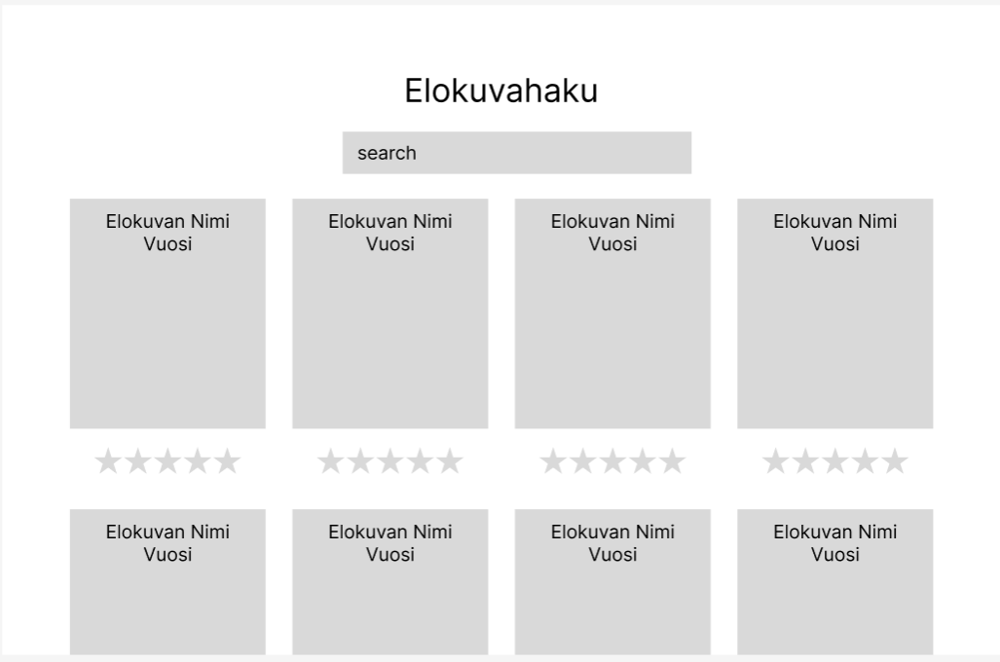

# Projekti-2a-AJAX-sovellus-REST-APIa-hy-dynt-en

# Elokuvahaku

**Tekijä(t):** Lidiia Molodtsova

## Projektisuunnitelma

### Projektin idea

Projektin ideana on elokuvien haku nimellä ja niiden esittäminen. Käyttäjä voi katsoa lisätietoja elokuvasta IMDb:n viralliselle sivustolle johtavan linkin kautta. Käyttäjä voi myös tallentaa arviotaan eri elokuvista. Sivusto on tarkoitettu ihmisille, jotka pitävät elokuvien katselusta.

### Suunnitellut toiminnot

Listaa vähintään kolme sovellukseesi suunniteltua toimintoa:

- Tietojen säilyttäminen sivun päivittämisen jälkeen
- Elokuvien haku nimen perusteella OMDb-API:n avulla
- Siirry linkin kautta IMDb:n viralliselle sivustolle

### Rautalankamalli / luonnos

Lisää tähän kuva käsin piirtämästäsi tai digitaalisesti tehdystä sovelluksen luonnoksesta. Luonnoksessa tulee näkyä sovelluksen pääasiallinen näkymä ja tärkeimmät elementit.

Esimerkki kuvan lisäämisestä:

## Verkkolinkit

- **Julkaistu sovellus:** [peppy-froyo-1c12a8.netlify.app]
- **GitHub-repositorio:** [https://github.com/lidimolo/Projekti-2a-AJAX-sovellus-REST-APIa-hy-dynt-en]
- **Projektin videoesittely:** [https://laureauas-my.sharepoint.com/:v:/g/personal/lim00039_laurea_fi/IQDs5nGbfTytSJdon8BN4Y7GAfAAkUeqnlzJbwe61E9tEk4?nav=eyJyZWZlcnJhbEluZm8iOnsicmVmZXJyYWxBcHAiOiJPbmVEcml2ZUZvckJ1c2luZXNzIiwicmVmZXJyYWxBcHBQbGF0Zm9ybSI6IldlYiIsInJlZmVycmFsTW9kZSI6InZpZXciLCJyZWZlcnJhbFZpZXciOiJNeUZpbGVzTGlua0NvcHkifX0&e=snz8AQ]

## Tietoja sovelluksesta

**Elokuvahaku** on verkkosovellus, jonka avulla käyttäjä voi etsiä elokuvia niiden nimellä. Sovellus näyttää elokuvien nimet, julkaisuvuodet ja julisteet. Käyttäjä voi myös arvioida elokuvia 1–5 tähdellä ja siirtyä IMDb-sivulle saadakseen lisää tietoa elokuvasta.

## Teknologiat

- HTML – sivun rakenne
- CSS – ulkoasu ja asettelu
- JavaScript – toiminnallisuus, DOM-skriptaus ja lomakkeiden validointi
- OMDb REST API – elokuvien tietojen hakeminen
- Fetch API – tietojen hakeminen palvelimelta
- JSON – API saatujen tietojen käsittely
- localStorage – viimeisimmän haun ja elokuvien arvioiden tallentaminen selaimeen

## Sovelluksen käyttö

Kirjoita lyhyet käyttöohjeet sovellukselle.

1. Avaa julkaistu sovellus yllä olevasta linkistä.
2. Kirjoita elokuvan nimi hakukenttään ja paina Haku-painiketta tai Enter-näppäintä.
3. Sovellus näyttää löytyneiden elokuvien nimet, julkaisuvuodet ja julisteet.
4. Klikkaa elokuvakorttia, jos haluat nähdä lisää tietoa IMDb-sivustolla.
5. Voit arvioida elokuvia antamalla 1–5 tähteä.
6. Päivitä sivu ja tarkista, että viimeisin haku ja antamasi arviot säilyvät.

## Sovelluksen käynnistäminen paikallisesti

1. Kloonaa tai lataa tämä repositorio omalle koneellesi.
2. Avaa projektikansio.
3. Avaa `index.html` selaimessa.

## Kuvakaappaukset

Lisää tähän vähintään yksi kuvakaappaus toimivasta sovelluksestasi.

Esimerkki kuvan lisäämisestä:

![Screenshot.png]

## Tunnetut virheet / puutteet

Sovelluksessa ei ole havaittu suuria virheitä. Haku näyttää vain 10 elokuvaa kerrallaan. Sovellus tarvitsee internetyhteyden toimiakseen.

## Työn jakautuminen

_Täytä tämä osio vain, jos teit projektin parityönä._

Kuvaile, miten työ jakautui ja miten yhteistyö sujui.

- Tekijä 1: ...
- Tekijä 2: ...

## Oma arvio ja oppimisen reflektointi

Pohdi työtäsi ja oppimisprosessiasi.

- Missä onnistuin?
  Onnistuin hakemaan tietoja API ja näyttämään ne verkkosivulla. Olen siitä iloinen
- Mikä oli haastavaa?
  JavaScript-koodin kirjoittaminen ja elokuvien arviointitoiminnon tekeminen.
- Mitä parantaisin, jos aikaa olisi enemmän?
  Haluaisin lisätä käyttäjälle oman profiilisivun, jossa hän voisi arvioida elokuvia ja kirjoittaa arvosteluja.
- Mitä opin HTML:stä, CSS:stä, JavaScriptistä ja DOM-skriptauksesta?
  Opin uusia JavaScript-funktioita ja ymmärrän nyt paremmin, miten JavaScript toimii yhdessä HTML ja CSS kanssa.
- Mikä jäi epäselväksi tai mistä haluaisin oppia lisää?
  Haluaisin oppia ymmärtämään JavaScriptiä paremmin ja käyttämään sitä itsenäisesti.
- Oma arvio projektista: **7/10 pistettä**

## Lähteet ja kiitokset

Listaa kaikki projektissa käyttämäsi lähteet, tutoriaalit, kuvat ja koodiesimerkit.

Jos käytit ChatGPT:tä, GitHub Copilotia tai muuta tekoälytyökalua, mainitse se tässä ja kerro lyhyesti, miten se tuki työskentelyäsi.

- [https://www.w3schools.com/js/]
- [https://www.omdbapi.com/]
- [https://www.imdb.com/?ref_=tt_nv_home]
- [Kuvalähde]
- Käytetty tekoälytyökalu: ChatGPT
  - Miten työkalua käytettiin: Käytin ChatGPTä JavaScript-koodin ymmärtämiseen, virheiden korjaamiseen ja uusien toimintojen tekemiseen. Sain myös apua CSS-tyylien suunnitteluun ja koodin selittämiseen.

  ## Lisenssi

Tämä projekti on lisensoitu MIT-lisenssillä.

Lisätietoa lisenssin lisäämisestä GitHub-projektiin:
https://docs.github.com/en/communities/setting-up-your-project-for-healthy-contributions/adding-a-license-to-a-repository
